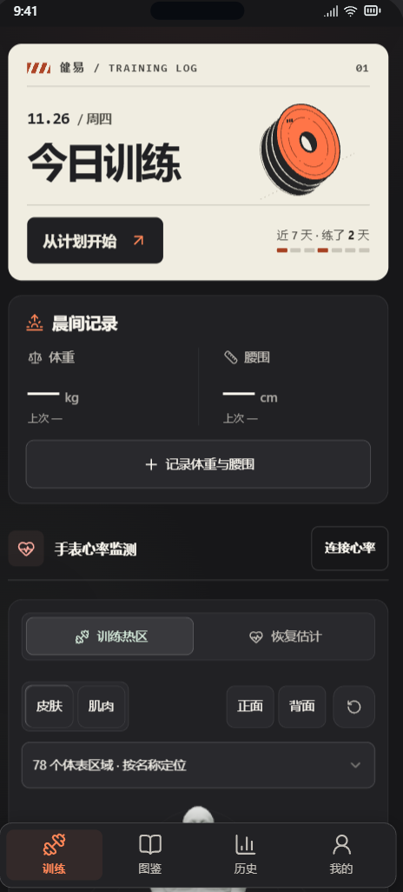
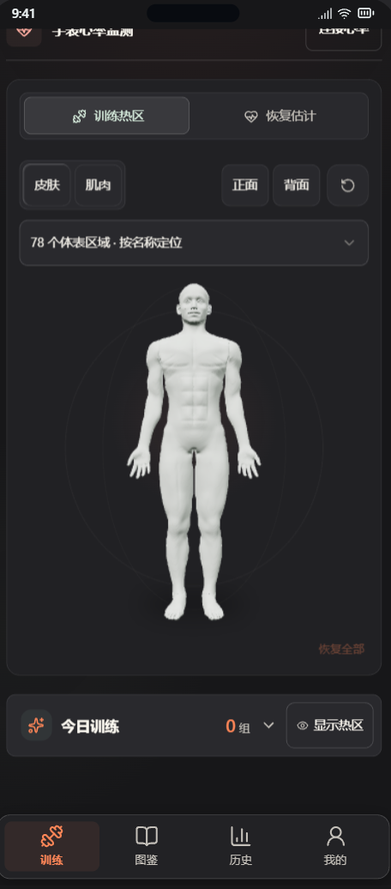
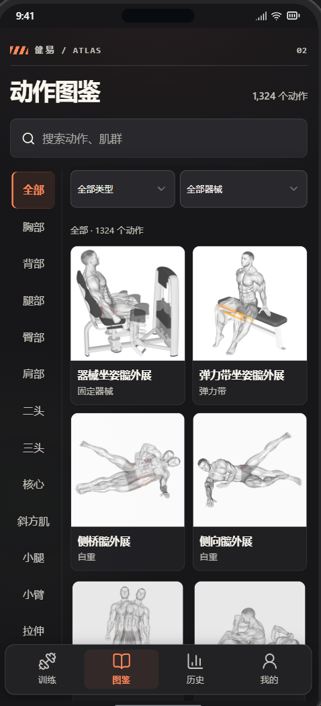
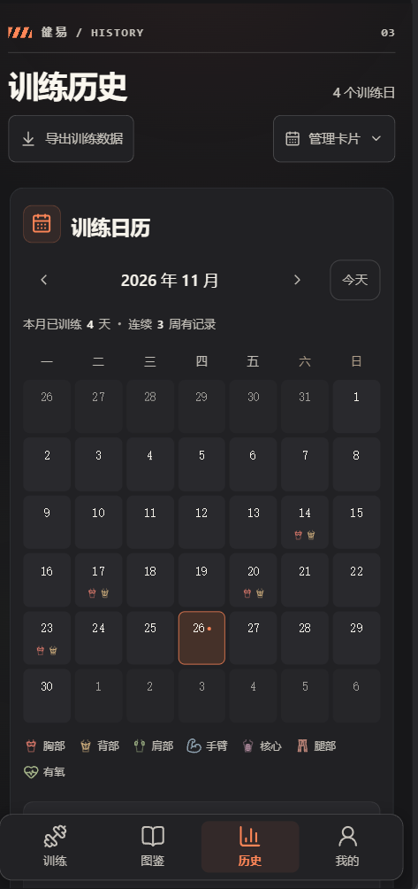
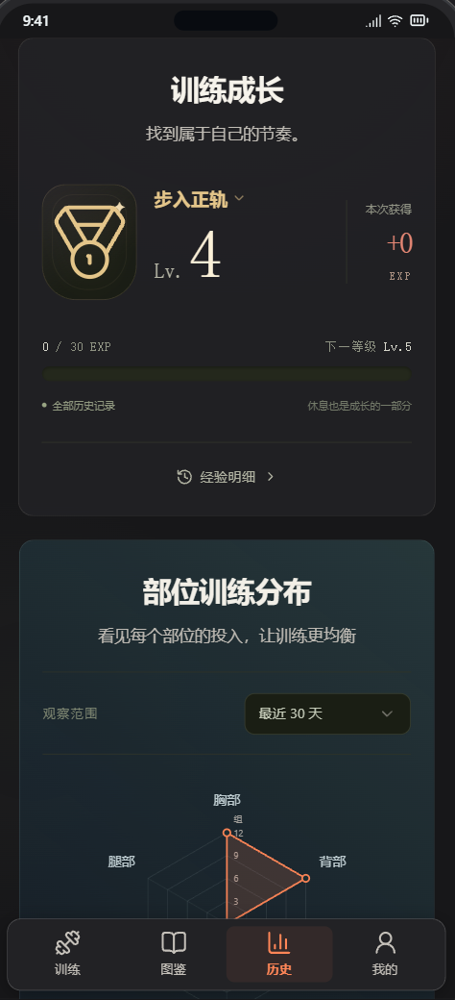
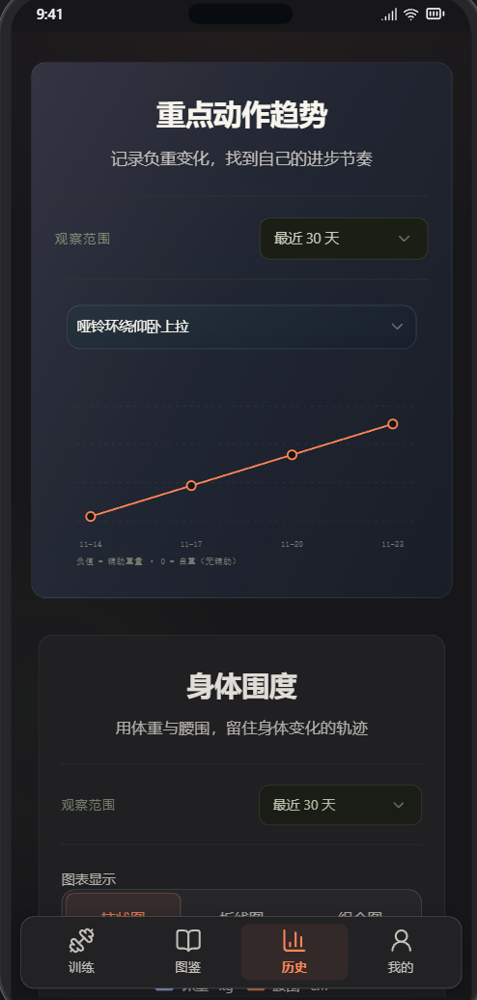
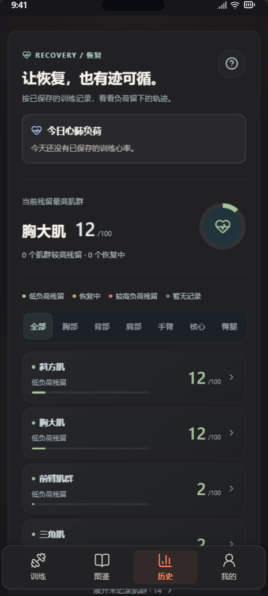
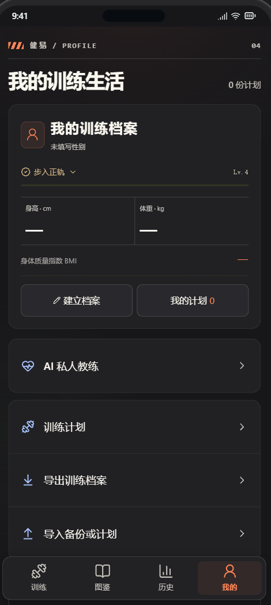

<!-- 可放应用图标，例如： -->

# 健易 (JianYi)

**来点健易，让健身更容易。**

一款专注训练本身的**离线优先、本地加密、无广告、免登录**的个人健身记录与辅助应用。

[📥 前往下载最新版本](https://github.com/liunian0416/jianyi/releases/latest) · [📱 界面预览](#-界面预览) · [✨ 核心功能](#-核心功能) · [📖 安装与更新](#-下载与安装指南) · [❓ 常见问题](#-常见问题)

---

## 💡 为什么做「健易」？

很多健身软件越做越重：打开先看广告、不登录不能用、地下室健身房没信号就打不开动作演示、导出自己的训练记录还要开会员。

**健易**想回到最纯粹的体验：
- **零门槛**：无需注册账号、无广告弹窗、不收集个人隐私。
- **真离线**：内置完整 3D 人体模型与 **1,324 个动作示范动图**，进健身房没信号也能流畅查阅与记录。
- **数据完全归你**：训练档案通过本地加密数据库存储，随时可导出标准 JSON 备份或跨设备迁移。
- **专业但不复杂**：日常记录极简顺手，同时把 3D 解剖、肌肉恢复估计、蓝牙心率监测和 AI 私人教练都装进一个应用里。

---

## 📱 界面预览

| 今日训练 | 3D 人体图谱 | 动作图鉴 | 训练日历 |
| :---: | :---: | :---: | :---: |
|  |  |  |  |

| 训练成长与部位分布 | 动作趋势与身体围度 | 肌肉恢复与心肺负荷 | 我的训练生活 |
| :---: | :---: | :---: | :---: |
|  |  |  |  |

---

## ✨ 核心功能

### 1. 顺手的日常训练记录
- **首页一站式开练**：清晰展示今日日期、近 7 天训练频次，支持**从计划开始**一键载入动作作为草稿逐项打卡，并集成**晨间记录**（快速登记体重与腰围）。
- **全面记录**：支持力量训练（重量、次数、组数）、有氧运动（时长、距离）、备注以及自定义动作；单个动作支持复用上次重量与次数。
- **自由整理**：支持长按拖拽调整动作顺序、侧滑操作，随时回顾、编辑或补录历史记录。

### 2. 交互式 3D 人体图谱 & 肌肉恢复估计
- **双模式与双视图**：支持在**训练热区 / 恢复估计**与**皮肤 / 肌肉**模型间自由切换，支持 360° 旋转、正背面切换、放大定位，并可通过 **78 个体表区域按名称定位**快速直达对应肌群的筛选动作。
- **本机恢复热图**：基于近期训练负荷在本地估算各肌群状态（**低负荷残留 / 恢复中 / 较高负荷残留**），支持按胸部、背部、肩部、手臂、核心、臀腿筛选查看具体恢复依据。

### 3. 内置 1,324 个全离线中文动作图鉴
- 收录 **1,324 个中文动作**（保留英文原名对照），覆盖 **19 大肌群**、**33 个力量训练细分**。
- 支持按 **力量、爆发力、有氧、拉伸与恢复** 四大类型以及**器械类型**组合筛选，并支持中英文与肌群关键词搜索。
- 所有示范动图全部打包在本地，无需联网缓冲，点击可放大细看动作细节。

### 4. 训练日历、多维图表与成长系统
- **训练日历**：月历按胸、背、肩、手臂、核心、腿部及有氧类型图标直观标记每日部位与连续训练周，点选日期即可查看当天完整动作与组次。
- **多维数据可视化**：
  - **部位训练分布雷达图**：一眼看清各部位训练投入是否均衡。
  - **重点动作趋势**：追踪核心动作的负重突破曲线。
  - **身体围度图表**：支持体重（kg）与腰围（cm）双轴动态缩放，自由切换柱状图、折线图、组合图，并与个人档案联动计算 BMI。
  - 支持自由管理历史页面的卡片显示与排序。
- **健身成长与称号**：按有效训练日、组数进步、重量突破、周身材变化累积经验升级，永久收藏从「初启征程」到「自成山海」的 12 阶成长称号。

### 5. 训练计划管理与隐私分享
- 可从历史记录一键提炼生成计划，或从零编排专属分化方案。
- 支持将计划导出为 JSON 分享给好友，提供**「仅动作」**与**「动作和组数」**两种模式——自动剔除你的真实重量、次数、围度与训练历史，分享模板不泄露个人隐私。

### 6. 蓝牙心率监测与心肺负荷
- 在训练页即可一键**连接心率**，支持通过蓝牙直连标准心率带或开启心率广播的运动手表。
- 训练中实时查看心率曲线，结束后自动汇总并结合最大心率计算各心率区间时长与**今日心肺负荷**。

### 7. AI 私人教练（自带 API，隐私完全可控）
- **自带接口，无中间商**：在「我的 → AI 私人教练」中支持填入任意 **OpenAI 兼容接口**（如 DeepSeek 等），自动获取模型列表；API Key 使用系统 Keystore 独立加密保存在本机，不经第三方服务器中转。
- **专业健身知识增强**：内置多部经典力量训练与运动营养知识卡片以及 *How to Train Better* 百条训练指南，按问题精准检索参考，回答下方透明展示实际参考的书籍与条目。
- **实用交互**：支持多会话保存、图片与文档（PDF / DOCX / TXT / CSV 等）附件解析，以及按需联网检索公开资料。
- **严格隐私确认**：默认不自动上传任何资料；每次发送个人训练摘要前均可展开预览并手动确认，年龄/性别/身高默认关闭；AI 仅提供文字建议，不会擅自改动你的训练记录。

---

## 🔒 隐私与数据安全

- **本地加密存储**：训练记录、身体测量、个人档案、AI 会话及 API Key 均采用 Android 原生 SQLite 与 **Android Keystore (AES-GCM)** 加密保存于设备本地。
- **无云端绑定**：没有账号体系，不上传用户训练数据，不申请无关的全盘存储或相册权限（文件导入导出通过系统 SAF 文件选择器授权）。
- **随时带走数据**：支持一键导出完整 JSON 备份，换手机或重装前可轻松备份并在新设备导入恢复。

---

## 📥 下载与安装指南

### 首次安装
1. 前往本仓库右侧的 **[Releases](https://github.com/liunian0416/jianyi/releases/latest)** 页面。
2. 下载最新版本的 `jianyi-android-x.x.x.apk` 安装包（系统要求：**Android 10 / API 29 及以上**）。
3. 在手机上直接安装即可离线使用。

### 版本升级（重要）
- **直接覆盖安装即可，切勿先卸载旧版本！** 卸载或清除应用数据会删除本机加密档案。
- 已安装新版后，可在 App 内 **「我的 → 版本更新」** 检查新版本并支持 Wi-Fi 下自动/手动下载更新。
- 重大版本升级前，仍建议先在 App 内导出一份 JSON 备份以防万一。

---

## ❓ 常见问题

<b>为什么安装包大约 400 MB？</b>

为了保证你在健身房地库、无网或弱网环境下也能流畅使用，健易把 **1,324 个动作示范动图**、**3D 人体肌肉与皮肤模型**以及**离线专业知识库**全部内置在了安装包中，不再依赖云端加载。

<b>换新手机怎么迁移训练数据？</b>

在旧手机的健易中导出完整 JSON 备份文件，发送到新手机后，在新手机的健易中选择导入该 JSON 文件即可完整恢复训练记录、身体测量、个人档案、计划与成长等级。

<b>不配置 AI 接口能正常使用吗？</b>

完全可以。AI 私人教练是完全可选的扩展功能，不配置任何 API 也不影响训练记录、3D 图谱、动作库、图表统计、蓝牙心率和恢复估计等全部核心功能。

<b>有 iOS 或桌面版吗？</b>

当前公开发行版本为 **Android 版**，后续视开发进度决定是否提供其他平台。

---

## 📜 致谢与免责声明

- **3D 人体模型**：基于 [Z-Anatomy](https://www.z-anatomy.com/) 开源解剖模型清理与定制，遵循其署名与许可要求。
- **动作示范动图**：动作示范媒体来源于 Gym Visual（© Gym visual），仅随应用内展示使用，请勿单独提取再分发。
- **训练指南知识库**：AI 教练本地参考收录了 [How to Train Better](https://github.com/Bel1eff-0228/How-to-Train-Better)（作者：栗子豪，CC BY-NC 4.0）及相关运动科学文献整理资料。
- **健康提示**：应用内的肌肉恢复估计、心肺负荷评分、BMI 计算及 AI 教练回复均仅供日常健身参考，**不构成医疗诊断或康复处方**。训练中如遇关节疼痛或身体不适，请及时停止并咨询专业医生或物理治疗师。

---

## 💬 反馈与交流

如果你在使用中遇到问题，或有好用的功能建议：
- 欢迎直接在本仓库提交 **[Issues](https://github.com/liunian0416/jianyi/issues)**
- 也可以在 App 内的「联系作者」中给我发邮件反馈

如果「健易」让你的健身更轻松了一点点，欢迎点一颗 ⭐ **Star** 支持一下！
